

 

<a href="https://github.com/AbdELRaou-Mohamed">_github-0d1117?style=for-the-badge&logo=github&logoColor=white" /></a>
<a href="https://www.linkedin.com/in/abd-elraouf-mohamed-4b38b23a9">_linkedin-0d1117?style=for-the-badge&logo=linkedin&logoColor=58a6ff" /></a>
<a href="mailto:am5437801@gmail.com">_email-0d1117?style=for-the-badge&logo=gmail&logoColor=ff6b35" /></a>
<a href="https://abdelraou-mohamed.github.io/AbdELRaou-Mohamed/portfolio.html">_portfolio-0d1117?style=for-the-badge&logo=googlechrome&logoColor=27c93f" /></a>
<a href="https://github.com/AbdELRaou-Mohamed/AbdELRaou-Mohamed/blob/main/cv-simple.pdf">_cv-0d1117?style=for-the-badge&logo=readme&logoColor=white" /></a>

---

## // about

Second-year Computer Science student passionate about Artificial Intelligence and Full-Stack development. I enjoy solving problems and turning ideas into real projects, while building a strong foundation in programming, data structures, and databases on my way to becoming a Software Engineer.

---

## // skills

Languages

Web

Tools

Core Concepts

---

## // projects

| Project | Description | Links |
|---|---|---|
| C++ Calculator | A calculator built in C++ that performs the four basic operations. | [Code](https://github.com/AbdELRaou-Mohamed/cpp-calculator) |
| Personal Portfolio | My personal website: who I am, what I'm learning, and my work. | [Live](https://abdelraou-mohamed.github.io/AbdELRaou-Mohamed/portfolio.html) |

More projects coming soon, I'm adding new ones as I build them.

---

## // certificates

<kbd>🏆 CLICK TO VIEW ALL 12 CERTIFICATES ▼</kbd>

 

<table>
  <tr>
    <td align="center" width="33%"><a href="certs/certs/ai-automation-brainsmingle.jpg">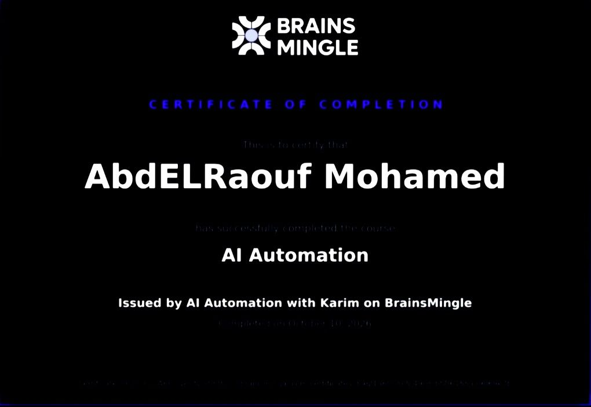</a> <b>AI Automation</b> Brains Mingle</td>
    <td align="center" width="33%"><a href="certs/certs/ois-ai-for-x.jpg">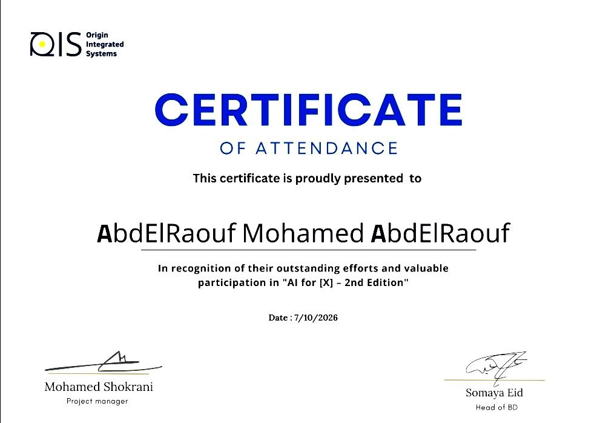</a> <b>AI for [X] 2nd Edition</b> Origin Integrated Systems</td>
    <td align="center" width="33%"><a href="certs/certs/hp-life-ai-for-beginners.jpg">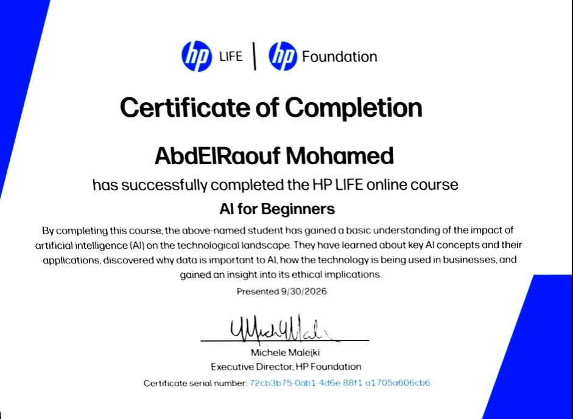</a> <b>AI for Beginners</b> HP LIFE</td>
  </tr>
  <tr>
    <td align="center"><a href="certs/certs/hp-life-data-science.jpg">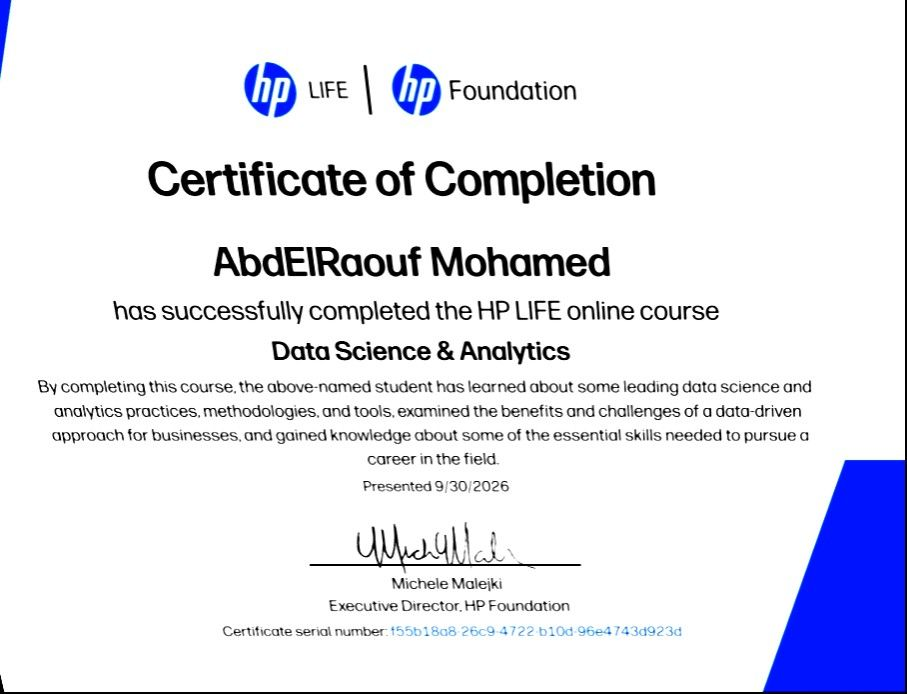</a> <b>Data Science & Analytics</b> HP LIFE</td>
    <td align="center"><a href="certs/certs/microsoft-genai-agents.jpg">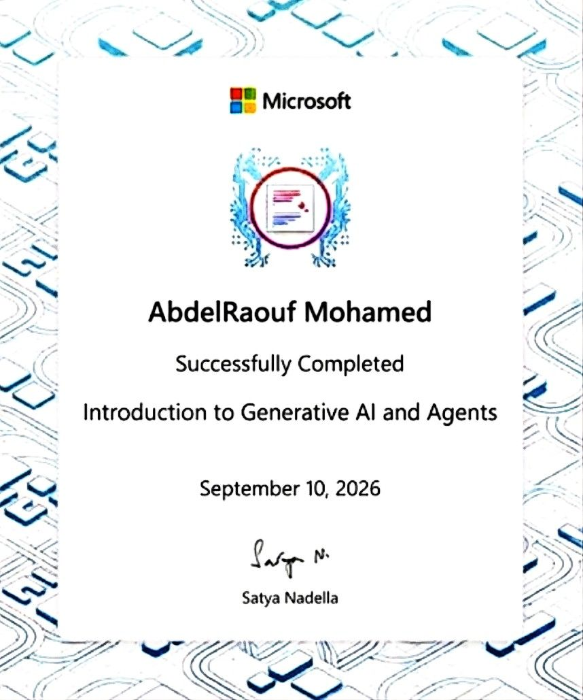</a> <b>Generative AI and Agents</b> Microsoft</td>
    <td align="center"><a href="certs/certs/cisco-intro-modern-ai.jpg">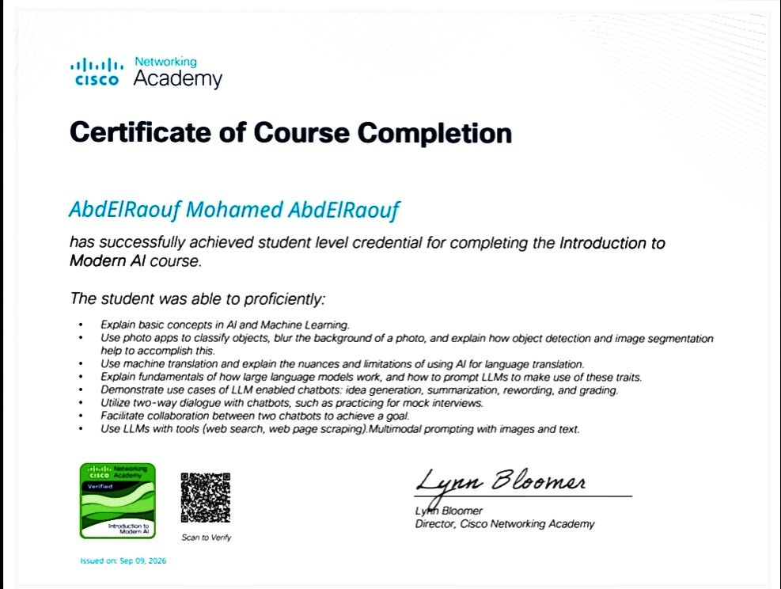</a> <b>Introduction to Modern AI</b> Cisco Networking Academy</td>
  </tr>
  <tr>
    <td align="center"><a href="certs/certs/cisco-tcsc-intro-modern-ai.jpg">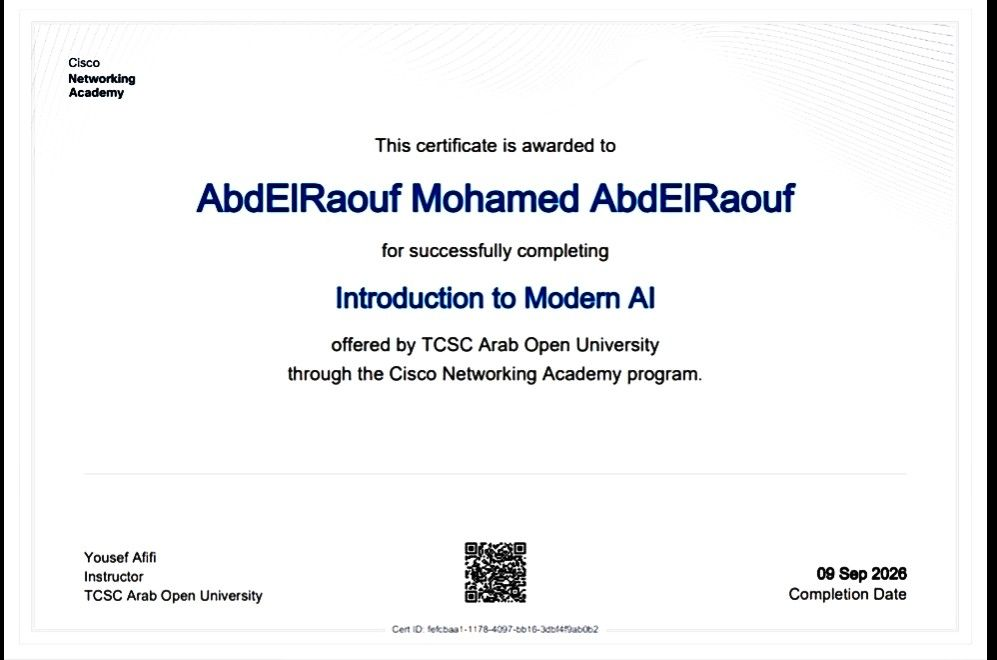</a> <b>Introduction to Modern AI</b> TCSC · Cisco</td>
    <td align="center"><a href="certs/certs/bue-ai-fundamentals.jpg">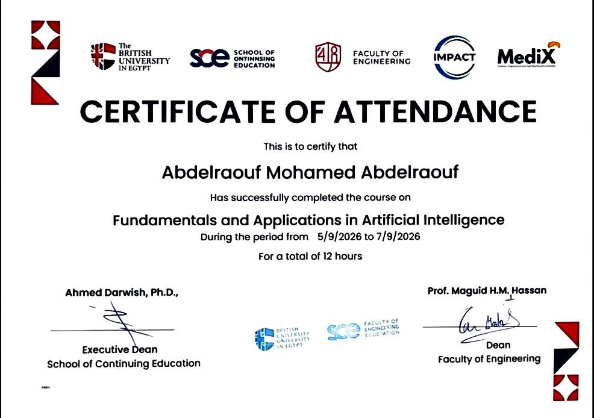</a> <b>AI Fundamentals & Applications</b> British University in Egypt</td>
    <td align="center"><a href="certs/certs/front-end-bootcamp.jpg">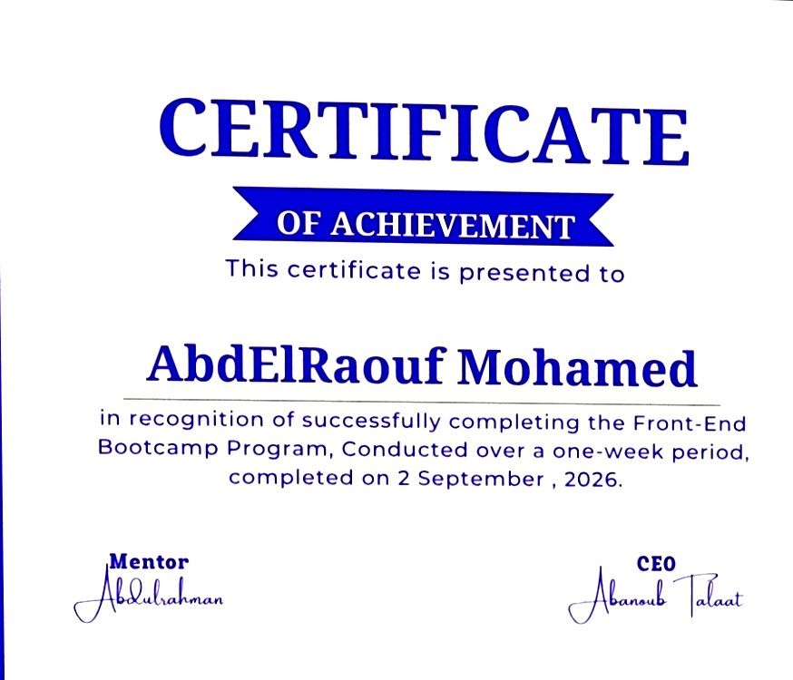</a> <b>Front-End Bootcamp</b> Certificate of Achievement</td>
  </tr>
  <tr>
    <td align="center"><a href="certs/certs/ibm-ai-fundamentals.jpg">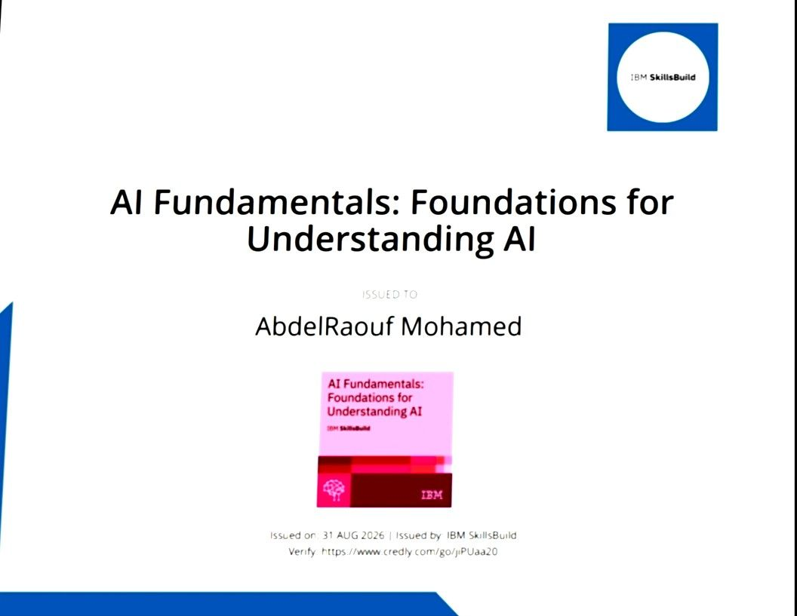</a> <b>AI Fundamentals</b> IBM SkillsBuild</td>
    <td align="center"><a href="certs/certs/genai-hackathon-2026.jpg">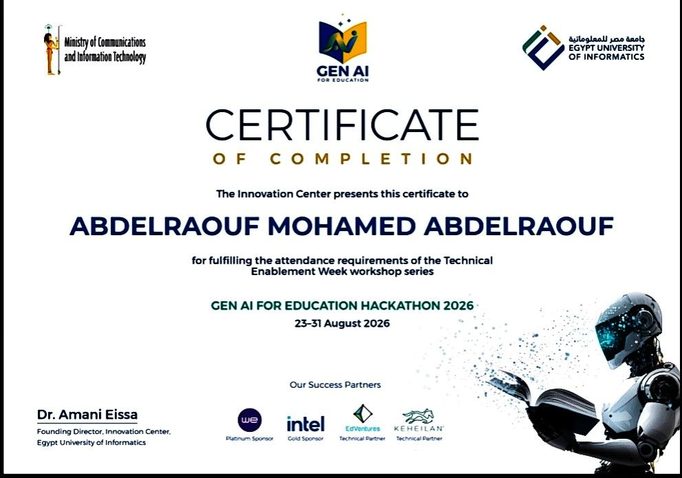</a> <b>GenAI for Education Hackathon</b> Egypt University of Informatics</td>
    <td align="center"><a href="certs/certs/iti-mongodb.jpg">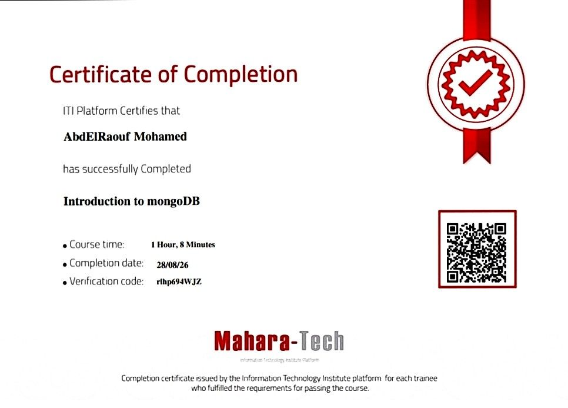</a> <b>Introduction to MongoDB</b> ITI · Mahara-Tech</td>
  </tr>
</table>

---

Always learning · Always building

