 

<a href="https://github.com/AbdELRaou-Mohamed">_github-0d1117?style=for-the-badge&logo=github&logoColor=white" /></a>
<a href="https://www.linkedin.com/in/abd-elraouf-mohamed-4b38b23a9">_linkedin-0d1117?style=for-the-badge&logo=linkedin&logoColor=58a6ff" /></a>
<a href="mailto:am5437801@gmail.com">_email-0d1117?style=for-the-badge&logo=gmail&logoColor=ff6b35" /></a>
<a href="https://abdelraou-mohamed.github.io/AbdELRaou-Mohamed/portfolio.html">_portfolio-0d1117?style=for-the-badge&logo=googlechrome&logoColor=27c93f" /></a>
<a href="https://github.com/AbdELRaou-Mohamed/AbdELRaou-Mohamed/blob/main/cv-simple.pdf">_cv-0d1117?style=for-the-badge&logo=readme&logoColor=white" /></a>

---

## // about

Computer Science student building a strong foundation in programming, problem solving, and databases. I learn by building real projects, and I'm working my way toward becoming a Software Engineer.

---

## // skills

Languages

Web

Tools

Core Concepts

---

## // projects

| Project | Description | Links |
|---|---|---|
| C++ Calculator | A calculator built in C++ that performs the four basic operations. | [Code](https://github.com/AbdELRaou-Mohamed/cpp-calculator) |
| Personal Portfolio | My personal website: who I am, what I'm learning, and my work. | [Live](https://abdelraou-mohamed.github.io/AbdELRaou-Mohamed/portfolio.html) |

More projects coming soon, I'm adding new ones as I build them.

---

## // certificates

<a href="https://abdelraou-mohamed.github.io/AbdELRaou-Mohamed/certificates.html">
_VIEW_MY_CERTIFICATES-0d1117?style=for-the-badge&logo=awesomelists&logoColor=ff6b35&labelColor=161b22" />
</a>

16 certificates · Microsoft · IBM SkillsBuild · Cisco Networking Academy · HP LIFE · ITI · and more

---

  Always learning · Always building

